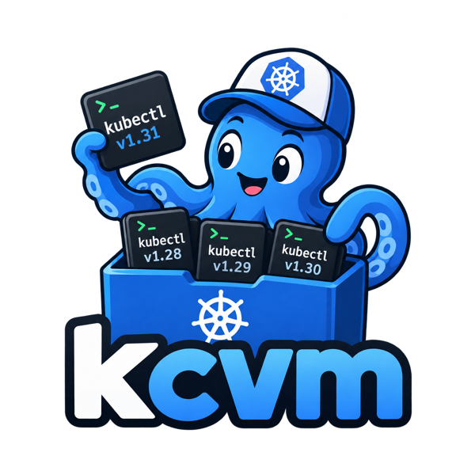

<p align="center">
  
</p>

<p align="center">
  <b><i>A kubectl version manager</i></b>
</p>

<p align="center">
  <a href="https://github.com/raqqun/kcvm/actions/workflows/test.yaml"></a>
</p>

kcvm installs several kubectl versions side by side and lets you switch between them,
so you can always use a kubectl that matches the cluster you are talking to.

## Installation

- Download the latest archive for your platform (linux or darwin, amd64 or arm64) from the [releases page](https://github.com/raqqun/kcvm/releases), e.g. for v0.3.1 on linux-amd64

`curl -L https://github.com/raqqun/kcvm/releases/download/v0.3.1/kcvm-v0.3.1-linux-amd64.tar.gz | tar -xz -C /tmp kcvm`

- Move it to $PATH

`sudo mv /tmp/kcvm /usr/local/bin`

Or build it with Go 1.23 or later:

`go install github.com/raqqun/kcvm/cmd/kcvm@latest`

## Commands

#### Initialize kcvm at ~/.kcvm

`kcvm init`

Add kcvm folder to your $PATH : `export PATH=$HOME/.kcvm:$PATH`

#### List available kubectl versions

`kcvm list remote`

Stable versions are listed from newest to oldest.

#### List installed kubectl versions

`kcvm list local`

The version in use is marked with `*`.

#### Install an available kubectl version

`kcvm install [VERSION]`

The installed version becomes the one in use. Use `--force` to download a version again.

#### Use a specific installed kubectl version

`kcvm use [VERSION]`

Versions can be written with or without the leading `v`, e.g. `v1.20.0` or `1.20.0`.

## How it works

kcvm keeps every kubectl binary in `~/.kcvm/bin` and points the `~/.kcvm/kubectl`
symlink to the version in use:

```
~/.kcvm/
├── kubectl -> ~/.kcvm/bin/kubectl-v1.20.0
└── bin/
    ├── kubectl-v1.19.4
    └── kubectl-v1.20.0
```

- Binaries are downloaded from `dl.k8s.io` for your OS and architecture and verified
  against their published sha256 checksum (releases older than v1.16 publish none).
- Downloads are written to a temporary file and moved into place only once complete
  and verified, and switching versions replaces the symlink atomically, so an
  interrupted command never leaves you without a working kubectl.
- Available versions are read from the tags of the
  [kubernetes repository](https://github.com/kubernetes/kubernetes) with a single git
  request, so listing them is not subject to GitHub API rate limits.

Use the global `--dir` flag to keep kcvm somewhere else than `~/.kcvm`, e.g.
`kcvm --dir /opt/kcvm install v1.20.0`.

## Development

`go test ./test/kcvm/` runs the tests against local fake servers, no network access is needed.

## Versioning

The [VERSION](VERSION) file holds the kcvm version, following [semver](https://semver.org).
Bump it for every new version: `kcvm --version` reports it and releases are tagged with it.

## Releasing

Releases are only created from pull requests:

1. Bump the version in the [VERSION](VERSION) file in a pull request to `master`.
2. The [Test](.github/workflows/test.yaml) workflow runs the tests and builds kcvm for every platform.
3. Once the pull request is merged, the [Release](.github/workflows/release.yaml) workflow
   tags the merge commit with the version and publishes the binaries with
   [GoReleaser](https://goreleaser.com), configured in [.goreleaser.yaml](.goreleaser.yaml).

Merged pull requests that leave VERSION unchanged release nothing. Versions with a
suffix, e.g. `v0.4.0-beta1`, are published as prereleases.
